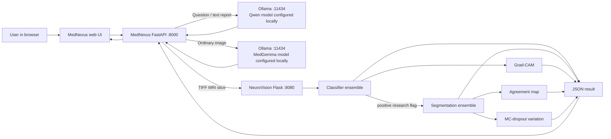

# Architecture

## System map



All service endpoints are configurable. The `127.0.0.1` defaults describe the demo topology; changing a URL can change where files and prompts are sent. Do not infer a privacy or compliance guarantee from the word “local”.

## Service responsibilities

| Service | Main responsibilities | Key routes |
|---|---|---|
| MedNexus (`mednexus/server/main.py`) | Serve browser assets, validate uploads, choose modality route, normalize specialist results, expose health/demo endpoints | `GET /`, `GET /api/health`, `POST /api/analyze`, `POST /api/explain`, `GET /api/demo` |
| NeuroVision (`neurovision-mri/app.py`) | Load available checkpoints onto CUDA, preprocess a TIFF slice, run classifier and optional segmentors, produce XAI | `GET /health`, `POST /api/predict`, `POST /api/explain` |
| Ollama | Run locally configured language/image models for non-TIFF review paths | Ollama API, normally port `11434` |

## MRI inference sequence

```mermaid
sequenceDiagram
  actor User
  participant Browser
  participant MN as MedNexus API
  participant NV as NeuroVision API
  participant GPU as CUDA device
  User->>Browser: Attach one .tif/.tiff and submit
  Browser->>MN: POST /api/analyze (multipart)
  MN->>NV: POST /api/predict (temporary upload)
  NV->>GPU: Resize/preprocess and run available classifiers
  GPU-->>NV: Per-model logits/scores
  NV->>NV: Average classifier outputs; apply configured threshold
  opt Positive slice flag
    NV->>GPU: Run available segmentation models
    GPU-->>NV: Per-model masks/probability maps
    NV->>NV: Average maps, threshold mask, calculate image-frame box
    NV->>NV: Generate Grad-CAM, agreement, and variation views
  end
  NV-->>MN: JSON with model output and visualizations
  MN-->>Browser: Structured result and plain-language context
  Browser-->>User: Show result, original slice, and XAI cards
```

The image is resized to the configured model input frame. A bounding box therefore uses coordinates from that processed frame; it is not a clinical size or severity measurement. Only available checkpoint models are loaded, so a local installation missing weights may run with a reduced ensemble.

## Repository layout

```text
mednexus/                 FastAPI API, browser UI, integrations
neurovision-mri/           MRI model, inference service, training and XAI
  src/models/              Classifier and segmentation network definitions
  src/explainability/      Grad-CAM, model comparison and variation views
  static/xai/              Labeled saved example visuals
  templates/               NeuroVision demo page
  checkpoints/             Local-only weights; ignored by Git
  kaggle_3m/                Local-only dataset; ignored by Git
tests/                     Fixture-based workflow checks
docs/                      Architecture, privacy, model and validation docs
output/                    Presentation and project sourcebook
```
