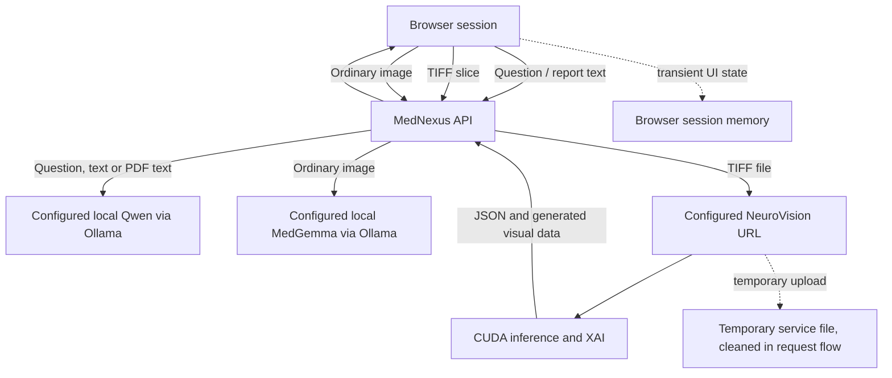

# Data flow and privacy boundaries

This document describes the current prototype behavior visible in source. It is not a security certification, privacy notice, or legal determination.

## Where information goes

## Current behavior

- No sign-in system or database is implemented. Chats, attached-file state, and profile fields are browser-session state; do not expect durable records after the session ends or page reloads.
- The profile name is kept in the browser and is not submitted with a review. Age and selected health context are sent only when the user explicitly chooses to add context to chat. The NeuroVision MRI endpoint uses the image; it does not receive that profile context.
- The MedNexus server accepts one file per review, with a 12 MB upload limit in the current implementation. Supported paths include TIFF/TIFF MRI to NeuroVision, ordinary images to the configured vision model, and text/selectable PDF content to the configured language model. Scanned PDFs do not receive OCR in this prototype.
- MRI uploads use temporary names and are removed in the request cleanup path. This does not mean all logs, browser state, model runtimes, OS caches, or configured remote services are automatically free of sensitive data.
- Service URLs and model tags can be changed in configuration. If a user points a service URL away from localhost, data will go to that configured destination.

## Safe demo practice

Use synthetic or approved, de-identified examples. Do not upload identifiable patient information. Use `.env.example` as a template and keep actual `.env` files out of Git. Review logs, temporary-file behavior, access controls, retention, backups, and vendor terms before handling any sensitive data.

## Before storing real records

A production design would need an explicit purpose and lawful basis, user/patient identity model, consent and access policy, encryption in transit and at rest, least-privilege controls, retention and deletion workflows, audit trails, backup and recovery, incident handling, and jurisdiction-specific privacy/security review. A database alone does not provide these controls.
