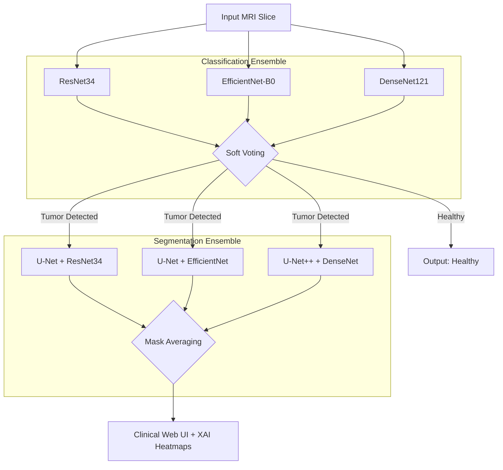
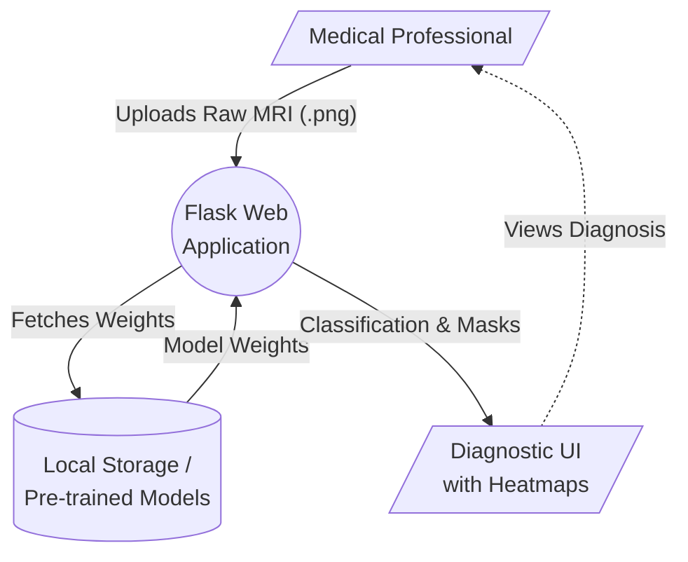
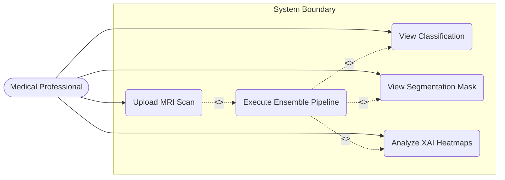
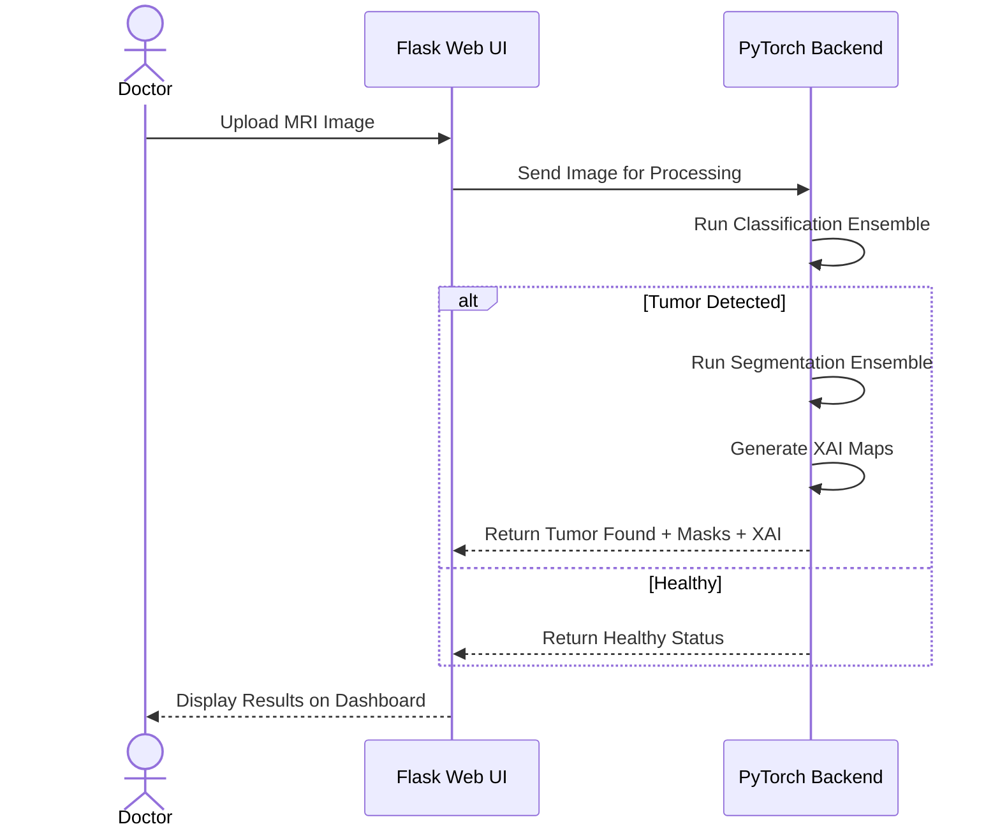

# College Presentation Outline (22 Slides)

````carousel
# Slide 1: Title Slide
- **Project Title:** Brain Tumor MRI Segmentation & Explainable AI Pipeline
- **Subtitle:** Multi-Model Ensemble Architectures under Severe Hardware Constraints
- **Presented by:** [Your Name / Team Members]
- **Under the Guidance of:** [Professor's Name]
- **Institution:** [College/University Name]
- **Date:** [Date]

<!-- slide -->
# Slide 2: Introduction
- **What are Lower-Grade Gliomas (LGG)?** 
  - Primary brain tumors originating from glial cells. 
  - Slower growing but can progress to fatal high-grade tumors.
- **Role of MRI:** 
  - The gold standard for neuro-oncology (no radiation, great soft-tissue contrast).
- **The Clinical Task:** 
  - Radiologists must analyze hundreds of 2D slices to locate and trace the tumor for surgical planning.

<!-- slide -->
# Slide 3: Motivation
- **Why Automate?** 
  - Manual segmentation is tedious, time-consuming, and prone to inter-observer variability (human error).
- **Why Explainable AI (XAI)?** 
  - Doctors cannot trust blind predictions. They need to see *why* the AI made a decision.
- **Why Hardware Constraints?** 
  - State-of-the-art medical AI requires expensive $10,000 GPUs. Our goal is to make this accessible on a standard 4GB VRAM college/clinic laptop.

<!-- slide -->
# Slide 4: Problem Statement
> *"While manual MRI segmentation is slow and subjective, the clinical adoption of Deep Learning is hindered by 'black-box' models and extreme hardware requirements. Therefore, the problem is to engineer an automated, interpretable MRI classification and segmentation pipeline that provides pixel-level accuracy while operating strictly within a consumer-grade 4GB VRAM constraint."*

<!-- slide -->
# Slide 5: Objectives
1. **Develop an Ensemble Architecture:** Combine multiple models to achieve high accuracy on limited medical data.
2. **Integrate Explainable AI (XAI):** Provide Grad-CAM and Uncertainty maps for clinical transparency.
3. **Optimize for Low Hardware:** Use Automatic Mixed Precision (AMP) and sequential loading to fit in 4GB VRAM.
4. **Deploy a Clinical Web Interface:** Build a user-friendly Flask app for doctors to upload scans and view results instantly.

<!-- slide -->
# Slide 6: Literature Survey (Part 1)
- **Traditional Methods:**
  - Used K-Means clustering and region-growing.
  - *Drawback:* Failed on complex tumor shapes and varied MRI lighting.
- **Rise of Deep Learning:**
  - Fully Convolutional Networks (FCNs) and specifically **U-Net** (Ronneberger et al., 2015) revolutionized medical imaging.
  - **ResUNet:** Adding residual connections (ResNet) to U-Net improved gradient flow and feature extraction.

<!-- slide -->
# Slide 7: Literature Survey (Part 2 - Gaps)
- **The "Black Box" Problem:** 
  - Standard U-Nets just output a mask. In high-stakes medicine, lack of reasoning is unacceptable.
- **Single-Model Bias:** 
  - Relying on one model leads to overfitting on small datasets.
- **Hardware Barrier:** 
  - Modern papers use 24GB+ GPUs. Very few papers address deployment on resource-constrained clinical machines.

<!-- slide -->
# Slide 8: Proposed System Overview
- **A Decoupled, Dual-Ensemble Approach:**
  1. **Phase 1 (Is there a tumor?):** A Classification Ensemble checks the MRI.
  2. **Phase 2 (Where is it?):** If a tumor exists, a Segmentation Ensemble draws the boundary.
  3. **Phase 3 (Why?):** XAI algorithms generate visual proof.
- *Advantage:* If Phase 1 says "Healthy", Phase 2 is skipped, saving massive computational power.

<!-- slide -->
# Slide 9: Detailed System Architecture
*(Include this diagram in your PPT)*


<!-- slide -->
# Slide 10: Data Flow Diagram (DFD Level 0)
*(Include this diagram in your PPT)*


<!-- slide -->
# Slide 11: UML Use Case Diagram
*(Include this diagram in your PPT)*


<!-- slide -->
# Slide 12: UML Sequence Diagram
*(Include this diagram in your PPT)*


<!-- slide -->
# Slide 13: Methodology - Classification Ensemble
- **Goal:** Determine tumor presence (Binary Classification: 0 or 1).
- **Models Used:**
  - **ResNet34:** Deep residual learning for core feature extraction.
  - **EfficientNet-B0:** Compound scaling for high accuracy with low parameters.
  - **DenseNet121:** Dense feature reuse to pick up micro-textures.
- **Fusion Strategy:** Soft Voting (Averaging the probability percentages of all three models).

<!-- slide -->
# Slide 14: Methodology - Segmentation Ensemble
- **Goal:** Tracing the exact pixel boundaries of the tumor.
- **Models Used:**
  - **U-Net + ResNet34 Encoder:** Standard robust segmentation.
  - **U-Net + EfficientNet-B0 Encoder:** Fast, lightweight feature extraction.
  - **U-Net++ + DenseNet121 Encoder:** Nested skip pathways to capture fine-grained tumor edges.
- **Fusion Strategy:** Mask Averaging (Pixels where models agree are highlighted stronger).

<!-- slide -->
# Slide 15: Methodology - Explainable AI (XAI)
- **Grad-CAM:** 
  - Looks inside the classification CNNs and creates a heat map over the regions that "triggered" the tumor prediction.
- **Agreement Maps:** 
  - Visually highlights which parts of the tumor boundary all 3 segmentors agreed on vs. disagreed on.
- **Monte Carlo Dropout Uncertainty:** 
  - Runs the image through the network with random nodes dropped out to visualize where the model is "unsure" about the boundary.

<!-- slide -->
# Slide 16: Software and Hardware Requirements
- **Hardware Limitations (The core challenge):**
  - Minimum 4GB VRAM GPU (e.g., NVIDIA RTX 3050 laptop).
  - 16GB System RAM.
- **Software Stack:**
  - **Language:** Python 3.12
  - **Deep Learning:** PyTorch, Torchvision
  - **Web Framework:** Flask
  - **Data Processing:** OpenCV, Albumentations (for augmenting data)
  - **Frontend:** HTML5, CSS3, JavaScript

<!-- slide -->
# Slide 17: Experimental Setup & Dataset
- **Dataset:** Kaggle LGG MRI Segmentation Dataset.
  - 110 Patients, ~3,929 MRI slices.
- **Data Splitting:** 
  - Strict Patient-Level Split (80% Train, 10% Val, 10% Test). Prevents data leakage where slices of the same brain end up in training and testing.
- **Data Augmentation:** 
  - Used Albumentations for Elastic Transforms, Grid Distortions, and Random Brightness to artificially expand the small dataset.

<!-- slide -->
# Slide 18: Results - Quantitative Metrics
Evaluated on the **Unseen Patient Test Set (349 slices)**:

- **Classification Performance:**
  - Accuracy: **95.70%**
  - F1 Score: **94.62%**
  - ROC AUC: **98.15%**
- **Segmentation Performance:**
  - Average Dice Score (F1): **88.33%**
  - Average Intersection over Union (IoU): **79.53%**

<!-- slide -->
# Slide 19: Results - Qualitative & UI
*(In your PPT, place screenshots of the Flask Web UI here)*
- **User Interface:** Clean, medical-aesthetic dashboard.
- **Instant Processing:** Upload an MRI, get results in seconds.
- **Visual Evidence:** Side-by-side display of the Original MRI, the Predicted Mask, and the Grad-CAM/Uncertainty heatmaps for clinical review.

<!-- slide -->
# Slide 20: Challenges & Optimizations
1. **Challenge:** 4GB VRAM was too small to fit the ensembles.
   - **Solution:** Used **Automatic Mixed Precision (AMP)** to halve memory usage (Float16), and loaded models sequentially into memory rather than concurrently.
2. **Challenge:** Very small dataset (110 patients).
   - **Solution:** Heavy spatial augmentations to prevent overfitting.
3. **Challenge:** Deep models output jagged edges.
   - **Solution:** Mask Averaging across the ensemble naturally smoothed out the borders.

<!-- slide -->
# Slide 21: Conclusion & Future Scope
- **Conclusion:** 
  - Successfully built a highly accurate, clinically transparent diagnostic assistant. 
  - Proved that advanced ensemble models and XAI can be practically deployed in low-resource environments (4GB VRAM).
- **Future Scope:**
  - Expand from 2D slices to full 3D volumetric MRI scans (3D U-Net).
  - Expand classification to multi-class (distinguishing between LGG, Glioblastoma, Meningioma).
  - Clinical trials with local hospitals.

<!-- slide -->
# Slide 22: References
1. Ronneberger, O., et al. (2015). *U-Net: Convolutional Networks for Biomedical Image Segmentation.*
2. He, K., et al. (2015). *Deep Residual Learning for Image Recognition.*
3. Selvaraju, R. R., et al. (2017). *Grad-CAM: Visual Explanations from Deep Networks.*
4. Buda, M., et al. (2019). *Association of genomic subtypes of lower-grade gliomas with shape features automatically extracted by a deep learning algorithm.* (Kaggle Dataset)
````
